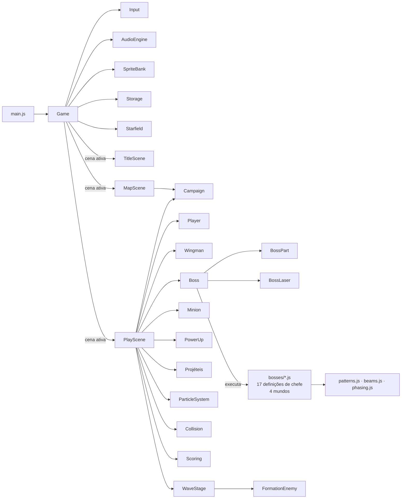

<div align="center">

# 🚀 NEBULA TITAN

**Um shoot 'em up retrô com chefes de partes destrutíveis: quatro mundos com dificuldade crescente, 12 mini-chefes, 4 chefes de mundo, rotas à sua escolha e uma fortaleza estelar que ocupa a tela inteira.**

*Releitura moderna dos clássicos arcade dos anos 80, inspirada em Galaga (Namco, 1981).*


[🎮 Jogar online](#-jogar-online) · [📖 Game Design](docs/GDD.md) · [🏗️ Arquitetura](docs/ARQUITETURA.md) · [🗺️ Planejamento](docs/PLANEJAMENTO.md) · [🇺🇸 English](README.en.md)

<!-- Quando tiver uma captura de tela/GIF, salve em docs/images/ e descomente a linha abaixo:

-->

</div>

---

## 📌 Sumário

1. [Sobre o projeto](#-sobre-o-projeto)
2. [Objetivos](#-objetivos)
3. [Modos de jogo e campanha](#-modos-de-jogo-e-campanha) · [Os quatro mundos](#os-quatro-mundos-v13)
4. [O chefe final: Leviatã](#-o-chefe-final-leviatã-a-fortaleza-estelar) · [O Titã](#-o-penúltimo-chefe-as-quatro-fases-do-titã)
5. [Funcionalidades](#-funcionalidades)
6. [Como jogar](#-como-jogar)
7. [Como executar](#-como-executar)
8. [Tecnologias utilizadas](#-tecnologias-utilizadas)
9. [Ferramentas utilizadas](#-ferramentas-utilizadas)
10. [Arquitetura e decisões técnicas](#-arquitetura-e-decisões-técnicas)
11. [Qualidade e testes](#-qualidade-e-testes)
12. [Conhecimentos adquiridos](#-conhecimentos-adquiridos)
13. [Estrutura do projeto](#-estrutura-do-projeto)
14. [Roadmap](#-roadmap)
15. [Créditos e inspiração](#-créditos-e-inspiração)
16. [Autor](#-autor)

---

## 🎯 Sobre o projeto

**Nebula Titan** nasceu como um projeto acadêmico de desenvolvimento de jogos. Para ensinar os fundamentos (game loop, entrada do usuário, colisão e estados de jogo), o professor apresentou à turma o clássico **Snake** (jogo da cobrinha). A proposta do grupo foi além da reprodução de um clássico: **pegar um jogo antigo e reinterpretá-lo com ideias de design de jogos atuais**.

O ponto de partida escolhido foi o **Galaga**, um dos *shoot 'em ups* mais icônicos da era arcade. Em vez de recriar suas ondas de inimigos, o projeto foca em algo que o original nunca teve: **uma batalha contra um chefe gigante, modular e reativo**, inspirada em mecânicas modernas como a quebra de partes de *Monster Hunter*, os pontos fracos de *Zelda* e a leitura de padrões de *bullet hell* contemporâneos.

> **A ideia central:** cada parte do chefe que você destrói **muda a aparência e o comportamento dele**. Arrancar a asa direita deixa a nave sem a asa, desequilibrada e inclinada para aquele lado. A asa que sobra passa a atacar com mais fúria e o gerador de escudo escondido atrás dela fica exposto. **A ordem das suas escolhas muda a luta.**

O escopo foi definido de forma deliberada e incremental: a **versão 1.0** entregou uma única batalha contra o chefe final, polida ao máximo. Com a base validada, a **versão 1.1** acrescentou uma **campanha com três mini-chefes** que concedem buffs, e a **versão 1.2** completou a progressão: **dois setores preparatórios** com alienígenas em formação (no estilo do Galaga) e um **chefe final gigante de 8 fases**, o **Leviatã**, em que os buffs coletados se tornam cada vez mais necessários. A **versão 1.3** transformou a campanha em um **sistema de progressão com 4 mundos**: cada mundo mantém o esquema de setores comuns, mini-chefes e um chefe, com dificuldade crescente, inimigos novos, 9 mini-chefes e 3 chefes inéditos, 12 buffs novos e progresso salvo. A evolução do escopo está registrada no [documento de planejamento](docs/PLANEJAMENTO.md).

## 🧭 Objetivos

| Dimensão | Objetivo |
|---|---|
| **Acadêmico** | Aplicar os fundamentos ensinados com o Snake (loop, input, colisão, estados) em um projeto de complexidade maior e autoral. |
| **Design** | Provar que um conceito retrô pode ganhar profundidade com princípios modernos: telegrafia de ataques, feedback visual, quebra de partes e escolhas com consequência. |
| **Técnico** | Construir um jogo completo **sem engine e sem bibliotecas**, com arquitetura organizada, código documentado e testes automatizados. |
| **Profissional** | Servir de **peça de portfólio** que demonstre domínio de JavaScript, organização de código, documentação técnica e processo de desenvolvimento. |

## 🗺️ Modos de jogo e campanha

| Modo | Descrição |
|---|---|
| **Campanha** | **4 mundos**, cada um com **2 setores** (obrigatórios) → **3 mini-chefes na ordem que quiser** (cada um dá um **buff permanente**) → **chefe do mundo**. O Mundo 4 termina no **LEVIATÃ** (chefe final). As vidas **acumulam** entre as fases (máximo 5). Se perder todas, você **recomeça a fase atual** com 3 vidas e os buffs mantidos, mas a pontuação é zerada. Zerar o jogo **sem nenhuma morte** vale **+100.000 pontos**. |
| **Continuar** | Retoma a campanha salva (o jogo salva após cada vitória). |
| **Mundo < N >** | Começa direto em um mundo já alcançado, com os buffs dos mundos anteriores. |
| **Mapa de progresso** *(v1.4)* | Mapa da galáxia com os 4 mundos: mostra onde você está, o que já venceu e o que falta. Tocar em um mundo abre as fases internas dele (setores, mini-chefes, chefe). Fases vencidas podem ser **rejogadas como treino**, sem alterar o save. |
| **Duelo com o Titã** | Luta direta contra o chefe final, sem buffs: o desafio puro da versão 1.0. |

### Os quatro mundos (v1.3)

A campanha é dividida em **4 mundos com dificuldade crescente**. Todos seguem a mesma estrutura: **2 setores comuns → 3 mini-chefes em ordem livre → chefe do mundo**. O Mundo 4 termina no **Leviatã**, o chefe final.

| Mundo | Tema | Setores (inimigo novo) | Mini-chefes (buff) | Chefe | Bônus do mundo |
|:---:|---|---|---|---|---|
| **1 · Nebulosa Carmim** | O começo | Setores 1-2 (verde e laranja) | Sentinela (Perfurante) · Colmeia (Ala) · Ceifador (Dash) | **Nebula Titan** | Bomba de Pulso |
| **2 · Cinturão Glacial** | Gelo e cristais | Setores 3-4 (**azul blindado**) | Prisma (Tiro Triplo) · Vórtice (Onda de Choque) · Escaravelho (Carapaça) | **Hidra Glacial** | Bomba Extra |
| **3 · Forja Estelar** | Fábricas e fogo | Setores 5-6 (**roxo divisor**) | Martelo (Sobrecarga) · Gêmeos (Ala Dupla) · Fornalha (Mísseis) | **Égide** | Recarga de Bomba |
| **4 · Vazio Abissal** | O coração da frota | Setores 7-8 (**vermelho kamikaze**) | Espectro (Fantasma) · Oráculo (Foco Amplificado) · Eco (Escudo Reativo) | **Arconte** → **LEVIATÃ** | Bomba Nova |

**Como a dificuldade sobe:** cada mundo acelera os ataques (+5% a +15%) e os projéteis inimigos (+5% a +12%), os setores mergulham e atiram com mais frequência, e os chefes chegam reforçados para compensar os buffs acumulados (Hidra +40%, Égide +50%, Arconte +60%, Leviatã +120% de vida). Cada mundo tem **paleta de estrelas, cor de fundo e música próprias**.

**Progresso salvo:** a campanha é salva no navegador após cada vitória (**CONTINUAR** no título). Mundos já alcançados ficam disponíveis em **MUNDO < N >**: você começa nele com os buffs dos mundos anteriores.

#### Mini-chefes e chefes dos mundos novos

| Encontro | Mecânica central |
|---|---|
| **Prisma** | Fragmentos orbitais lançam cristais que **se dividem no ar**; fragmento destruído estilhaça em anel. |
| **Vórtice** | Uma **gravidade puxa a sua nave**; na fase 2 ela pulsa e também **empurra**. O dash escapa da força. |
| **Escaravelho** | O núcleo fica atrás de uma **carapaça indestrutível que abre e fecha**: ataque na janela certa. |
| **Hidra Glacial** (chefe) | Cabeças que **renascem** se você não cortar as duas em 9 s, **sopro congelante** (raio que varre a tela), escamas blindadas e um coração que regenera. |
| **Martelo** | **Pancadas** avisadas por sombra que soltam **ondas de choque** rente ao chão. |
| **Gêmeos** | Duas naves em órbita ligadas por um **raio letal**; derrubar uma enfurece a outra. |
| **Fornalha** | **Colunas de fogo** com faixa de aviso e, na fase 2, dois **raios giratórios** como ponteiros de relógio. |
| **Égide** (chefe) | Quatro canhões, um **anel de escudo blindado giratório**, um **canhão de raio que varre** e um núcleo que regenera. |
| **Espectro** | Sai de fase: fica **intangível** (tiros atravessam), teletransporta e reaparece atirando. |
| **Oráculo** | *Bullet hell* de flores de projéteis que **fazem curva**: feito para o **modo foco**. |
| **Eco** | Uma **cópia sombria da sua nave** que segue você; na fase 2 voa espelhada e faz projéteis **subirem do fundo da tela**. |
| **Arconte** (chefe) | Usa a tecnologia de todos os guardiões: cápsulas orbitais, gravidade, **tesoura de raios**, máscara blindada e espectral e um núcleo final com tudo junto. |

### Os setores (ondas em formação)

Cada mundo começa com duas fases obrigatórias de **ondas em formação**, uma homenagem direta ao Galaga: os alienígenas entram fazendo curvas, montam uma formação que "respira" no topo da tela e mergulham contra você. Se errarem o mergulho, voltam para a vaga. Os setores não dão buffs, só **pontos** (abater em mergulho vale o dobro).

| Inimigo | Vida | Ataque | Comportamento |
|---|:---:|---|---|
| **Alienígena verde** | 1 | 1 agulha mirada | Frágil e numeroso; mergulha sozinho ou como escolta |
| **Alienígena laranja** | 3 | Leque de 3 tiros | Fica na fileira de cima e mergulha **puxando escoltas verdes** |
| **Alienígena azul** *(Mundo 2)* | 7 | Cristal que se divide em anel | **Blindado**: fica na fileira de cima e mergulha devagar |
| **Alienígena roxo** *(Mundo 3)* | 2 | 2 agulhas | **Divisor**: ao ser destruído, vira **2 drones verdes** que mergulham na hora |
| **Alienígena vermelho** *(Mundo 4)* | 1 | Nenhum | **Kamikaze**: mergulha muito rápido e persegue a nave |

Todos os tipos também aparecem como **escolta** nas lutas contra os chefes.

### Os mini-chefes do Mundo 1

| Mini-chefe | Mecânica | Como ele muda | Buff ao derrotar |
|---|---|---|---|
| **Sentinela** | Olho blindado cercado por **3 cápsulas orbitais**; depois, **barreiras giratórias** | Cada cápsula destruída faz as restantes girarem e atirarem **mais rápido**. Na fase 2, é preciso atirar **pelas brechas** das barreiras. | **Tiro Perfurante**: +50% de dano e os tiros atravessam drones |
| **Colmeia** | Nave-mãe orgânica com **2 ninhos** que fabricam drones; depois, a **rainha** | Perder um ninho faz a Colmeia **pender** para aquele lado e o ninho restante produzir **mais rápido**. | **Ala Companheira**: uma nave aliada, que a Colmeia mantinha presa, passa a voar e atirar ao seu lado (homenagem à nave dupla do Galaga) |
| **Ceifador** | Nave-lâmina que faz **investidas telegrafadas** contra o jogador | Sem uma lâmina, ele se desequilibra e investe com **mais frequência**. Na fase 2, investidas mais rápidas explodem em projéteis no fundo da tela. | **Dash**: investida rápida e invencível (você aprende a manobra dele) |
| *Os três derrotados* | — | — | **Bomba de Pulso**: limpa a tela e fere o chefe (2 cargas por luta) |

**A ordem importa também aqui:** os buffs conquistados mudam as lutas seguintes. Quem derrota a Colmeia primeiro ganha a nave aliada para enfrentar a Sentinela; quem começa pelo Ceifador ganha o dash para escapar das barreiras e cápsulas. No final, a tela de vitória mostra **a rota escolhida**. Para compensar os buffs, o Titã chega **reforçado (+80% de vida)** na campanha.

## 🛸 O chefe final: LEVIATÃ, a fortaleza estelar

Último encontro do Mundo 4, depois do Arconte. Uma nave **maior que a tela**: o jogador voa **sobre o casco** e, a cada fase, a câmera avança para a próxima das **8 seções**, da popa até a proa. O casco é **desenhado proceduralmente** e cada seção tem visual próprio. Cada seção é construída em torno de um buff, que fica **cada vez mais necessário, mas nunca obrigatório**:

| Seção | Pontos fracos | Ameaça | Buff que brilha |
|:---:|---|---|---|
| 1 · Motores | 2 torretas de popa | Leques mirados + escoltas | — (aquecimento) |
| 2 · Hangares | 2 portas de hangar | Lançam alienígenas sem parar | Ala Companheira / Perfurante |
| 3 · Baterias Blindadas | 3 baterias | **Blindagem**: tiros comuns causam só 35% do dano | **Tiro Perfurante** (ignora a blindagem) · +1 bomba |
| 4 · Corredor de Lasers | 2 emissores | **Paredes de laser** com uma brecha estreita | **Dash** (atravessa em qualquer ponto) |
| 5 · Reatores Gêmeos | 2 reatores | **Regeneram** quando não são atingidos | **Ala Companheira** (poder de fogo) · +1 bomba |
| 6 · Tempestade | Canhão de tempestade | Cortina densa de projéteis | **Bomba de Pulso** |
| 7 · Ponte de Comando | Ponte blindada | Blindagem + lasers + escoltas laranja | Perfurante + Dash · +1 bomba |
| 8 · Núcleo | Núcleo regenerativo | Espirais, anéis, lasers e escoltas | **Todos** |

## 👾 O chefe do Mundo 1: as quatro fases do Titã

O **NEBULA TITAN** é uma nave-mãe montada a partir de **8 partes independentes**. Cada uma tem vida, hitbox, aparência danificada e recompensa próprias. A luta avança em quatro fases, e cada fase expõe um novo ponto fraco:

| Fase | Ponto fraco | Comportamento | Mudança visual |
|:---:|---|---|---|
| **1 · Asas de Combate** | Asa esquerda e asa direita | Leques de tiros pelas torretas das asas e anéis de energia. Ao perder uma asa, a outra entra em fúria (mais cadência + rajada em varredura). | A asa destruída **some**; a nave **inclina** para o lado danificado, treme e solta faíscas do "toco". |
| **2 · Geradores de Escudo** | Os geradores escondidos sob as asas | Minas teleguiadas, leques de agulhas e esquadrões de drones que mergulham no estilo Galaga. Um escudo de energia envolve o casco. | O escudo **enfraquece** a cada gerador perdido; os geradores viram **carcaças** escurecidas e soltando fumaça. |
| **3 · Canhão Principal** | O canhão sob o casco | O chefe persegue o jogador e dispara um **laser** com aviso prévio. Abaixo de 50% de vida, o laser passa a **varrer** a tela. | O canhão **racha** progressivamente e vira sucata ao ser destruído. |
| **4 · Núcleo Exposto** | O núcleo de energia | A placa blindada é **arrancada**. O Titã enfurecido dispara espirais que ficam mais densas conforme o núcleo enfraquece. | Casco em **tom vermelho**, luzes piscando, núcleo pulsante e a música acelera. |

**Mecânicas que fazem a ordem importar:**

- **Quebra antecipada:** destruir uma asa expõe o gerador daquele lado, que **já pode ser destruído durante a fase 1** (bônus de +5.000). Se os dois geradores caírem cedo, a fase 2 é **pulada**.
- **Assimetria:** perder a asa esquerda ou a direita primeiro produz inclinações, rotas de fuga e origens de tiro diferentes.
- **Recompensas por parte:** cada parte destruída solta um power-up diferente (tiro duplo, escudo, tiro rápido, vida extra).
- **Leitura sem texto:** tiros em partes blindadas **ricocheteiam** (som metálico e faísca cinza); os pontos fracos atuais são marcados com colchetes pulsantes.

A especificação completa está no [Game Design Document](docs/GDD.md).

## ✨ Funcionalidades

- 🌌 **4 mundos com dificuldade crescente**, cada um com setores, 3 mini-chefes e um chefe, além de paleta, fundo e música próprios.
- 🧩 **17 chefes modulares** (12 mini-chefes, 4 chefes de mundo e o Leviatã) com partes destrutíveis, fases e 3 estados visuais de dano por parte (intacta → rachada → em chamas → carcaça).
- ⚙️ **Mecânicas de chefe variadas**: gravidade que puxa a nave, chefes intangíveis, carapaças que abrem e fecham, cabeças que renascem, raios letais com aviso, projéteis que se dividem e fazem curva, e ataques que vêm do fundo da tela.
- 🗺️ **Campanha com rota à escolha**, mapa de seleção por mundo, **16 buffs** (tiro perfurante e triplo, duas naves aliadas, dash com onda de choque, mísseis teleguiados, carapaça, bombas e mais) e sistema de *continue*.
- 💾 **Progresso salvo** no navegador e **seleção de mundo** no menu.
- 🗺️ **Mapa de progresso** *(v1.4)*: galáxia com os 4 mundos, as fases internas de cada um e **modo treino** para rejogar fases vencidas.
- 👽 **Setores com alienígenas em formação** (5 tipos: verde, laranja, azul blindado, roxo divisor e vermelho kamikaze) no estilo clássico do Galaga: entrada em curvas, formação que "respira" e mergulhos com escolta.
- 🛸 **Chefe final de 8 fases maior que a tela**, com câmera que avança seção por seção e casco gerado por código; blindagem, regeneração e paredes de laser.
- ❤️ **Vidas acumuladas** (máximo 5), vida extra a cada 50.000 pontos e bônus de **corrida perfeita** (sem mortes).
- 🎨 **Pixel art gerada por código** (com suporte a substituição por PNGs desenhados à mão, sem alterar a jogabilidade).
- 🔊 **Áudio 100% sintetizado** em tempo real (efeitos + trilha musical com sequenciador), sem nenhum arquivo de som.
- 💥 **Game feel moderno**: *hit-stop*, tremor de tela, flashes, partículas, ondas de choque e destroços com física.
- 🎯 **Design justo**: hitbox reduzida, ataques telegrafados, modo foco (movimento preciso) e limpeza de tela ao morrer.
- 🏆 **Pontuação e rank** (S/A/B/C) com bônus de tempo, precisão e "sem dano", além de recorde salvo no navegador.
- 📱 **Feito para celular também** *(v1.4)*: botões de **bomba, dash e pausa** na tela, menus 100% por toque, **tela cheia** em modo retrato, aviso para girar o aparelho, respeito ao *notch*, **vibração** e **instalável como app (PWA)**, inclusive **offline**.
- 🧪 **257 testes automatizados**: todos os chefes e setores, a campanha de 4 mundos, salvar/carregar, o mapa de progresso, os controles de toque, as mecânicas novas, colisões, pontuação e integridade dos sprites, além de **testes de garantia** que jogam cada chefe só com tiros vindos de baixo para provar que nenhum fica imortal.
- 🐞 **Modo debug** (`?debug`) com hitboxes, contador de FPS, invencibilidade, todos os buffs e atalho para pular fases.

## 🕹️ Como jogar

| Ação | Teclado | Toque (celular) |
|---|---|---|
| Mover | `Setas` ou `W A S D` | Arrastar o dedo |
| Atirar | `Espaço`, `Z` ou `J` (segure) | Automático ao tocar |
| Modo foco (lento + hitbox visível) | `Shift` | — |
| Dash *(buff do Ceifador)* | `C` ou `L` | Botão **DASH** (acima da bomba) ou um **segundo dedo** |
| Bomba de Pulso *(após os 3 mini-chefes)* | `X` ou `K` | Botão **BOMBA** no canto inferior direito |
| Navegar nos menus/mapas | `Setas` + `Enter` | Tocar na opção (no mapa: tocar de novo para jogar) |
| Mapa de progresso (na Rota de Ataque) | `Tab` | Botão **MAPA** |
| Pausar | `P` ou `Esc` | Botão ⏸ no canto superior direito |
| Voltar ao menu (pausado) | `Q` | Botão **MENU** da pausa |
| Ligar/desligar som | `M` | Botão **SOM** no título |
| Ligar/desligar vibração | `V` | Botão **VIBRA** no título |
| Tela cheia | `F` | Botão **TELA CHEIA** no título |

**Dica:** a nave só é atingida no **pontinho central** (ative o modo foco para vê-lo). Use os colchetes amarelos para saber onde atirar.

## ▶️ Como executar

### 🎮 Jogar online

> **[▶ Jogar agora: nebula-titan.vercel.app](https://nebula-titan.vercel.app)**, hospedado na Vercel e publicado automaticamente a cada *push* na branch `main`.

**No celular:** abra o link e use **"Adicionar à tela inicial"** (Android: menu do Chrome → *Instalar app*; iPhone: Safari → Compartilhar → *Adicionar à Tela de Início*). O jogo abre em tela cheia, como um app, e funciona **sem internet** depois da primeira visita.

### 💻 Localmente

Pré-requisito: [Node.js](https://nodejs.org/) 18 ou superior (usado só para o servidor local e os testes, porque o jogo em si não tem dependências).

```bash
git clone https://github.com/n4nd00o/nebula-titan.git
cd nebula-titan
npm start
```

Acesse **http://localhost:5173**.

> **Por que um servidor?** O jogo usa **módulos ES** (`import`/`export`), e os navegadores bloqueiam módulos em páginas abertas direto do disco (`file://`). Alternativas equivalentes: a extensão *Live Server* do VS Code ou `python -m http.server`.

### 🐞 Modo debug

Acesse **http://localhost:5173/?debug** para habilitar:

| Tecla | Função |
|---|---|
| `T` | Destrói instantaneamente os pontos fracos atuais / todos os alienígenas da onda (pula fases) |
| `G` | Liga/desliga a invencibilidade |
| `B` | Concede todos os buffs (para testar o Duelo com buffs) |
| `H` | Mostra/oculta hitboxes (verde = vulnerável, cinza = blindado) |

## 🛠️ Tecnologias utilizadas

| Tecnologia | Onde é usada | Por que foi escolhida |
|---|---|---|
| **JavaScript (ES2022+)** | Todo o jogo | Linguagem nativa da web; roda em qualquer navegador sem instalação. Uso de classes, módulos, *destructuring*, *optional chaining*, `Proxy` (nos testes) e `async/await`. |
| **ES Modules** | Organização do código | Separação real de responsabilidades por arquivo, sem *bundler*. |
| **HTML5 Canvas 2D** | Renderização | API de desenho imediato, ideal para pixel art e controle total do *pipeline* gráfico (composição aditiva, transformações, manipulação de pixels com `ImageData`). |
| **Web Audio API** | Efeitos sonoros e música | Síntese em tempo real com osciladores, ruído filtrado e envelopes, a mesma lógica dos chips de som 8-bit. Agendamento preciso pelo relógio do `AudioContext`. |
| **CSS3** | Layout e escala | Centralização responsiva e `image-rendering: pixelated` para manter os pixels nítidos. |
| **Pointer Events API** | Controle por toque | Um único modelo de eventos para mouse, toque e caneta. |
| **localStorage** | Recorde e preferência de som | Persistência simples no navegador, com tratamento de erro para modo privado. |
| **Node.js** | Servidor local e testes | Executa o servidor estático (`scripts/serve.mjs`) e a suíte de testes. |
| **node:test** | Testes automatizados | *Test runner* nativo do Node, sem dependências externas. |
| **GitHub Actions** | Integração contínua | Roda os testes automaticamente a cada *push* e *pull request*. |
| **Vercel** | Hospedagem e deploy contínuo | Publica o jogo como site estático; cada *push* no GitHub gera um novo deploy automaticamente. |

> **Por que não usar uma engine (Unity, Godot) ou biblioteca (Phaser)?** Por decisão pedagógica e de portfólio: implementar o game loop, a colisão, a renderização e o áudio "na mão" demonstra entendimento dos fundamentos que as engines abstraem. Detalhes em [ARQUITETURA.md](docs/ARQUITETURA.md#por-que-sem-engine).

## 🧰 Ferramentas utilizadas

| Ferramenta | Finalidade |
|---|---|
| **Visual Studio Code** | Editor de código |
| **Git** | Controle de versão |
| **GitHub** | Hospedagem do repositório, CI (Actions), integrado à Vercel para o deploy |
| **Node.js / npm** | Scripts de execução e testes |
| **DevTools do navegador** | Depuração, *profiling* de desempenho e inspeção do canvas |
| **Claude Code (IA)** | Assistente de programação usado no planejamento, na implementação e na revisão |
| **Piskel / Aseprite / LibreSprite** *(opcional)* | Edição de pixel art para substituir os sprites gerados por código |
| **Mermaid** | Diagramas de arquitetura dentro do Markdown |

## 🏗️ Arquitetura e decisões técnicas



Principais decisões (explicadas em profundidade em [docs/ARQUITETURA.md](docs/ARQUITETURA.md)):

1. **Game loop com passo fixo (*fixed timestep*)**: a simulação roda sempre a 60 atualizações por segundo, independentemente do monitor (60 Hz ou 144 Hz). Isso garante comportamento determinístico e justo.
2. **Máquinas de estado**: o jogo (Título → Jogo → Pausa/Vitória/Derrota) e o chefe (entrada → combate ⇄ transição → morte) são máquinas de estado explícitas, o que evita condicionais espalhadas.
3. **Composição em vez de herança**: o chefe é um conjunto de `BossPart`. Adicionar uma parte nova não exige mudar a classe `Boss`.
4. **Motor de chefes genérico e orientado a dados**: os **17 chefes** usam a mesma classe `Boss`. Cada chefe é só um arquivo de definição (`src/boss/bosses/`) com partes, fases e ganchos opcionais (inclinação, órbitas, desenhos extras, raios letais, gravidade, intangibilidade). Os 12 chefes da v1.3 foram adicionados **sem nenhuma condicional específica** no motor: só ganchos genéricos novos.
11. **Campanha como dados**: os 4 mundos são uma tabela (`WORLDS` em `Campaign.js`) com setores, mini-chefes, chefe, bônus, dificuldade, música e tema. A campanha é **serializável** (`toJSON`/`fromJSON`) para salvar o progresso.
5. **Inversão de dependência**: o `Boss` conversa com a cena por uma interface (o "mundo") e não conhece o DOM. Por isso ele pode ser **testado no Node.js** com um mundo falso.
6. **Arte procedural com fallback para PNG**: os sprites são definidos como texto e as variações de dano (rachaduras, carcaça, flash, fúria) são **geradas por algoritmo**. Um PNG desenhado à mão pode substituir qualquer sprite sem alterar hitboxes.
7. **Abstração de entrada**: o código pergunta por **ações** (`fire`, `left`) e não por teclas, então teclado e toque compartilham a mesma lógica.
8. **Interface comum de "encontro"**: uma fase de ondas (`WaveStage`) implementa a mesma interface de um chefe (`update`, `state`, `phaseIndex`, `hitTestPath`...), então a cena de jogo roda os dois sem saber qual é qual (polimorfismo por *duck typing*).
9. **Colisão por pixel com detecção contínua**: as partes do chefe só são atingidas onde há pixel visível, e o trajeto do tiro entre quadros é verificado em passos de 4 px (sem "atravessar" peças finas).
10. **Gerenciamento de memória**: remoção de entidades por compactação *in-place* (`removeDead`), o que evita criar arrays novos a cada quadro e reduz pausas do *garbage collector*.

## ✅ Qualidade e testes

```bash
npm test
```

A suíte (257 testes, catalogados em [docs/TESTES.md](docs/TESTES.md)) cobre:

- **Lógica do chefe**: progressão de fases, invulnerabilidade na entrada e nas transições, quebra antecipada, fase pulada, inclinação por asa perdida, *hit test* (ricochete × dano) e o fluxo completo até a derrota.
- **Colisão**: AABB, círculo × círculo, círculo × retângulo, distância ponto-segmento (laser) e **colisão por pixel** nas partes do chefe (com testes de regressão de bugs reais).
- **Todos os chefes (testes genéricos)**: cada chefe registrado tem a definição validada, cada alvo é verificado como atingível na sua fase e o fluxo completo até a derrota é simulado. Um chefe novo ganha esses testes **automaticamente**.
- **Garantia "nenhum chefe imortal"** *(v1.4, `tests/reachability.test.js`)*: o teste joga cada chefe **como o jogador**, varrendo a tela com tiros retos que sobem do fundo, e só conta o dano quando o tiro chega ao ponto fraco sem bater em outra peça antes, por uma **janela de tiro de pelo menos 12 px** (uma fresta de 3 px não conta, porque ninguém consegue mirar nela). Cada fase precisa ser vencida dentro do limite de tempo. O mesmo arquivo confere as **hitboxes**: máscara de colisão = sprite, nenhum "acerto fantasma" fora do desenho e raio dos alienígenas compatível com o tamanho do sprite.
- **Documentação**: todo arquivo de teste precisa estar no catálogo e toda versão precisa do seu relatório de entrega (`tests/docs.test.js`).
- **Mapa de progresso e celular**: estados das fases (vencida/disponível/bloqueada), histórico que sobrevive ao fim da campanha, saves antigos, layout sem sobreposição, zonas de toque, botões da pausa e vibração (inclusive em aparelhos sem suporte).
- **Mecânicas dos mini-chefes**: rotação acelerada das cápsulas, barreiras bloqueando tiros, produção de drones por ninho e o ciclo aviso → investida → retorno do Ceifador.
- **Setores**: as ondas cabem na formação, as vagas são únicas, os inimigos entram, formam, mergulham e atiram, e o setor termina quando todos caem.
- **Leviatã**: câmera avançando exatamente uma seção por fase, blindagem × perfurante, regeneração dos reatores, ausência de dano por contato e paredes de laser (brecha e aviso).
- **Campanha**: os 4 mundos em sequência, setores obrigatórios antes dos mini-chefes, buffs em qualquer ordem, bônus de mundo, Leviatã só depois do Arconte, dificuldade crescente, seleção de mundo, **salvar/carregar** (inclusive saves inválidos), vidas acumuladas (máx. 5), *continue* e corrida perfeita.
- **Mecânicas dos mundos novos**: projéteis que se dividem e fazem curva, mísseis teleguiados, cabeças da Hidra que renascem, sopro com aviso, carapaça que bloqueia o núcleo, gravidade que puxa e empurra, raios dos Gêmeos e da Fornalha, pancada do Martelo, intangibilidade do Espectro, o Eco seguindo o jogador e as 5 fases do Arconte.
- **Pontuação**: bônus, ranks e casos de borda (divisão por zero e tempo acima do par).
- **Integridade da arte**: largura consistente dos sprites, cores existentes na paleta, simetria e espelhamento das asas.
- **Utilitários matemáticos**: interpolação, rotação, ângulos e gerador pseudoaleatório determinístico.

Além dos testes unitários, **os 25 encontros da campanha** (8 setores, 12 mini-chefes, 4 chefes e o Leviatã) são validados com uma **simulação headless** da cena completa, com todos os buffs ativos, até a tela de vitória e a troca de mundo. A verificação visual é feita com capturas de tela do jogo no Edge headless. Antes disso, **a campanha e o duelo** já eram validados com uma **simulação headless** (DOM falso + "bot" jogando): título → mapa → 3 mini-chefes → Titã → vitória, e também derrota → *continue*. A mesma simulação foi usada para **medir a duração de cada luta** e balancear a dificuldade.

## 🎓 Conhecimentos adquiridos

### Técnicos
- **Arquitetura de jogos**: game loop com passo fixo, separação entre *update* e *render*, cenas e máquinas de estado.
- **Matemática aplicada**: vetores, trigonometria (mira, espirais, rotação de hitboxes), interpolação, *easing* e detecção de colisão geométrica.
- **Computação gráfica 2D**: Canvas API, transformações, modos de composição (`lighter`, `source-atop`), manipulação de pixels com `ImageData` e geração procedural de texturas.
- **Áudio digital**: síntese subtrativa, envelopes ADSR simplificados, ruído filtrado e agendamento de eventos musicais com *lookahead*.
- **Engenharia de software**: modularização, composição, design orientado a dados, inversão de dependência, **refatoração para generalizar** (de 1 chefe para um motor de N chefes, e de 1 campanha para N mundos), serialização de estado (salvar/carregar), *clean code* e documentação técnica.
- **Testes automatizados**: testes unitários com `node:test`, *test doubles* com `Proxy` e simulação headless.
- **DevOps básico**: versionamento com Git, integração contínua com GitHub Actions e deploy contínuo com a Vercel.

### Design de jogos
- **Design de chefes**: fases, pontos fracos, telegrafia de ataques, escalada de dificuldade e recompensas.
- **Game feel / "juice"**: *hit-stop*, tremor de tela, partículas e feedback audiovisual imediato.
- **Legibilidade e justiça**: linguagem visual de cores (amarelo = jogador, rosa/laranja = inimigo), hitbox reduzida e comunicação sem texto (ricochete).
- **Balanceamento**: ajuste de vida, cadência e densidade de projéteis com base em testes de jogo e em métricas da simulação.
- **Progressão e escolha**: rota não linear, recompensas que mudam as lutas seguintes e compensação de dificuldade (Titã reforçado na campanha).

### Comportamentais
- **Definição e controle de escopo**: começar com *uma* batalha excelente e só expandir (campanha) depois da base validada.
- **Planejamento iterativo**: protótipo → núcleo jogável → polimento → documentação.
- **Comunicação técnica**: documentar decisões para professores, colegas e recrutadores.

## 📁 Estrutura do projeto

```
nebula-titan/
├── index.html               # Página do jogo
├── manifest.webmanifest     # PWA: nome, ícones, tela cheia em retrato
├── sw.js                    # Service worker (instalar e jogar offline)
├── css/style.css            # Layout, escala do canvas, áreas seguras e aviso de girar
├── src/
│   ├── main.js              # Ponto de entrada
│   ├── config.js            # Constantes e parâmetros de balanceamento
│   ├── core/                # Motor: loop, entrada (teclado/toque), áudio, vibração, armazenamento
│   ├── graphics/            # Paleta, sprites em texto, SpriteBank, texto
│   ├── systems/             # Partículas, colisão, fundo, pontuação, campanha, progresso
│   ├── entities/            # Jogador, nave aliada, projéteis, alienígenas, power-ups, lasers
│   ├── boss/                # Motor de chefes: partes, laser, padrões de tiro
│   │   └── bosses/          # 17 definições de chefe (4 mundos + Leviatã)
│   ├── stages/              # Setores de ondas: diretor (WaveStage) e dados das ondas
│   ├── encounters.js        # Registro de todos os encontros (setores + chefes)
│   ├── scenes/              # Título, mapa de progresso, rota de ataque e batalha
│   └── utils/               # Funções matemáticas puras
├── assets/sprites/          # PNGs opcionais (substituem a arte gerada)
├── assets/icons/            # Ícones do app (PWA)
├── tests/                   # Testes automatizados (node:test)
├── scripts/serve.mjs        # Servidor estático de desenvolvimento
├── docs/                    # GDD, arquitetura, planejamento, guias e diário
└── .github/workflows/ci.yml # Integração contínua
```

## 📚 Documentação

| Documento | Conteúdo |
|---|---|
| [docs/PLANEJAMENTO.md](docs/PLANEJAMENTO.md) | Contexto, ideia inicial × final, escopo, requisitos, cronograma e riscos |
| [docs/GDD.md](docs/GDD.md) | Game Design Document: mecânicas, chefe, fases, pontuação, arte e áudio |
| [docs/ARQUITETURA.md](docs/ARQUITETURA.md) | Arquitetura de software, diagramas e decisões técnicas |
| [docs/GUIA_DE_SPRITES.md](docs/GUIA_DE_SPRITES.md) | Como desenhar e substituir os sprites |
| [docs/DIARIO_DE_DESENVOLVIMENTO.md](docs/DIARIO_DE_DESENVOLVIMENTO.md) | Registro cronológico do desenvolvimento |
| [docs/TESTES.md](docs/TESTES.md) | Catálogo dos testes: o que cada arquivo garante, bugs que viraram teste e como verificar o jogo |
| [docs/RELATORIOS_DE_ENTREGA.md](docs/RELATORIOS_DE_ENTREGA.md) | Relatórios de cada versão, na íntegra (registro do progresso) |
| [CHANGELOG.md](CHANGELOG.md) | Histórico de versões |

## 🗺️ Roadmap

- [x] Núcleo do motor (loop, entrada, cenas, áudio)
- [x] Chefe modular com 4 fases e quebra de partes
- [x] Game feel (partículas, hit-stop, tremor, flashes)
- [x] Pontuação, rank e recorde
- [x] Suporte a toque e modo debug
- [x] Testes automatizados e CI
- [x] Campanha com 3 mini-chefes, rota à escolha e buffs (v1.1)
- [x] Motor de chefes genérico (novos chefes = novos arquivos de dados)
- [x] Setores de ondas em formação + chefe final de 8 fases maior que a tela (v1.2)
- [x] Progressão em 4 mundos, 12 chefes novos, 3 alienígenas novos, 12 buffs novos, save e seleção de mundo (v1.3)
- [x] Mapa de progresso com modo treino, testes de garantia contra chefes imortais e versão para celular: botões, tela cheia, vibração e PWA offline (v1.4)
- [ ] Sprites desenhados à mão (modo misto)
- [ ] Menu de opções (volume, reduzir tremor de tela, dificuldade)
- [ ] Suporte a gamepad (Gamepad API)
- [ ] Ranking online
- [ ] Modo "Boss Rush" com todos os chefes já derrotados
- [ ] Testes de jogo com pessoas para ajustar a dificuldade dos mundos 2 a 4

## 🙏 Créditos e inspiração

- **Galaga** © Bandai Namco Entertainment. Este é um projeto **acadêmico, autoral e sem fins comerciais**, *inspirado* no gênero e na era do jogo original. Nenhum nome, personagem, arte ou som do Galaga foi utilizado.
- Paleta de cores baseada na **Sweetie 16**, de GrafxKid.
- Fonte **Press Start 2P**, de CodeMan38 (SIL Open Font License), via Google Fonts.
- Referências de design: *Monster Hunter* (quebra de partes), *The Legend of Zelda* (pontos fracos), *Touhou* e *Ikaruga* (legibilidade de *bullet hell*).

## 👤 Autor

**Luiz Fernando Santana**
Estudante de [CURSO] na [INSTITUIÇÃO]

- GitHub: [@n4nd00o](https://github.com/n4nd00o)
- LinkedIn: [linkedin.com/in/luiz-fernando-santana-trindade](https://www.linkedin.com/in/luiz-fernando-santana-trindade/)
- E-mail: luizfernandosantanadev@gmail.com

<!-- Se o projeto foi feito em grupo, liste aqui os demais integrantes e o papel de cada um. -->

## 📄 Licença

Distribuído sob a licença **MIT**. Veja [LICENSE](LICENSE) para mais informações.
