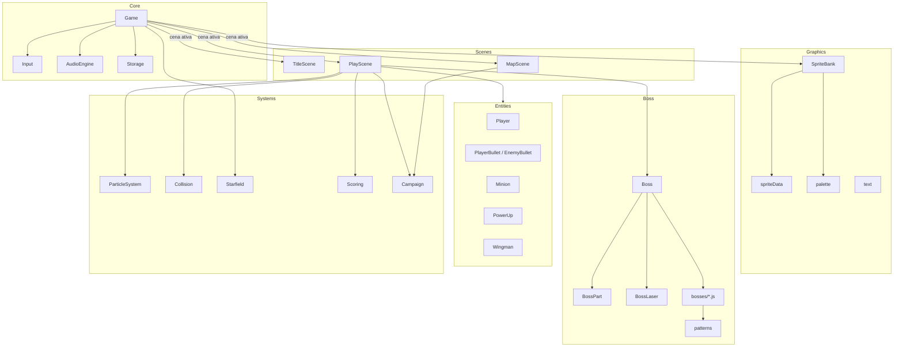
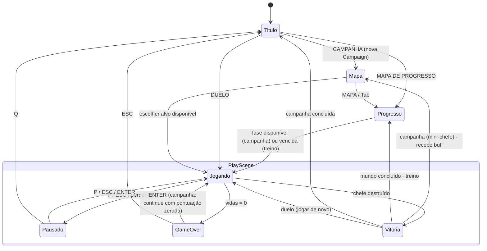
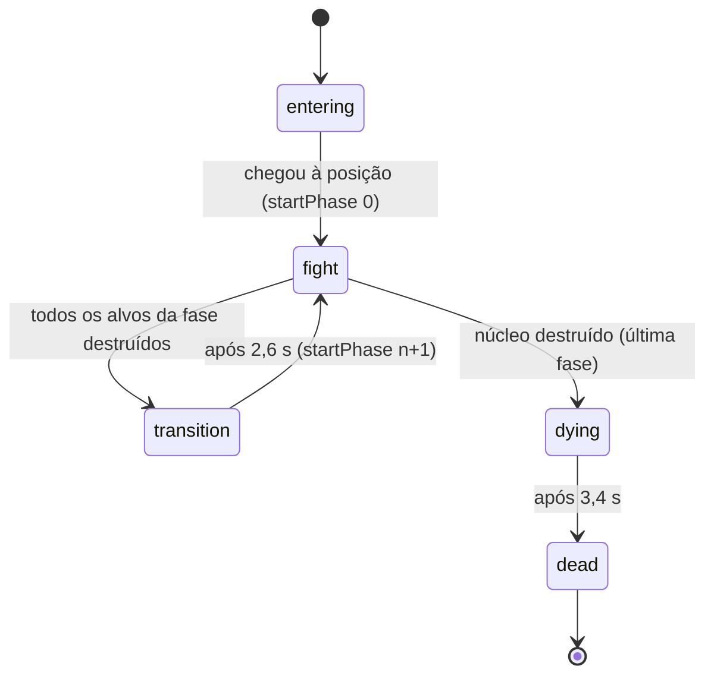
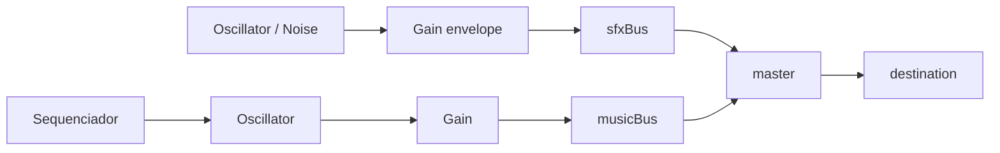

# 🏗️ Arquitetura: Nebula Titan

> Como o jogo é organizado por dentro e por que cada decisão foi tomada.

---

## 1. Visão geral

O projeto é uma aplicação **JavaScript pura** (sem frameworks, sem engine e sem *bundler*) organizada em **módulos ES**. O código é dividido em camadas com responsabilidades bem definidas:

| Camada | Pasta | Responsabilidade |
|---|---|---|
| **Core** | `src/core/` | Infraestrutura: game loop, entrada, áudio, armazenamento |
| **Graphics** | `src/graphics/` | Paleta, definição dos sprites, geração de variações, texto |
| **Systems** | `src/systems/` | Serviços reutilizáveis: partículas, colisão, fundo, pontuação |
| **Entities** | `src/entities/` | Objetos do jogo: jogador, projéteis, drones, power-ups |
| **Boss** | `src/boss/` | O chefe: partes, laser, padrões de tiro e dados das fases |
| **Scenes** | `src/scenes/` | Telas do jogo (título e batalha) |
| **Utils** | `src/utils/` | Funções matemáticas puras |



<a id="por-que-sem-engine"></a>
## 2. Por que sem engine?

| Critério | Engine (Unity/Godot/Phaser) | JavaScript puro (escolhido) |
|---|---|---|
| Aprendizado dos fundamentos | Abstraídos pela engine | Implementados e compreendidos |
| Tamanho final | MBs de runtime | ~100 KB de código-fonte |
| Execução | Requer build/export | Abre direto no navegador |
| Portfólio | Mostra domínio da ferramenta | Mostra domínio dos **conceitos** |

Para um projeto de escopo controlado (uma fase), o custo de escrever o motor é baixo e o ganho de aprendizado é alto.

## 3. Game loop com passo fixo

Arquivo: [`src/core/Game.js`](../src/core/Game.js)

```js
loop(time) {
  let frameTime = (time - this.lastTime) / 1000;
  this.lastTime = time;
  if (frameTime > MAX_FRAME_TIME) frameTime = MAX_FRAME_TIME; // evita "espiral da morte"

  this.accumulator += frameTime;
  while (this.accumulator >= FIXED_STEP) {   // FIXED_STEP = 1/60 s
    this.update(FIXED_STEP);
    this.accumulator -= FIXED_STEP;
  }
  this.draw();
  requestAnimationFrame(this.loop);
}
```

**Por quê?** Com `dt` variável, a física muda conforme o monitor: projéteis "atravessam" alvos em quedas de FPS e jogos em 144 Hz ficam diferentes de jogos em 60 Hz. Com **passo fixo**, a simulação avança sempre em incrementos de 1/60 s; o *render* apenas mostra o estado mais recente. O resultado é um jogo **determinístico e justo**.

O teto `MAX_FRAME_TIME` (0,25 s) impede que, após a aba ficar em segundo plano, o jogo tente simular segundos inteiros de uma vez.

## 4. Cenas (máquina de estados do jogo)



Cada cena implementa a mesma interface informal: `enter()`, `exit()`, `update(dt)`, `draw(ctx)` e `onBlur()`. O `Game` só conhece essa interface.

### 4.0 Setores de ondas

Arquivos: [`src/stages/WaveStage.js`](../src/stages/WaveStage.js), [`src/stages/stageData.js`](../src/stages/stageData.js), [`src/entities/FormationEnemy.js`](../src/entities/FormationEnemy.js)

- **`WaveStage`** é o diretor da fase e também a **formação**: `slotPos({col,row})` calcula a posição de cada vaga com balanço e "respiração".
- **`FormationEnemy`** é uma máquina de estados: `waiting → entering` (trajetória paramétrica `swoop`/`side`/`dive`) `→ toSlot → formation → diving` (salto, curva de perseguição, tiro) `→ toSlot` (se sair por baixo, reaparece no topo).
- O diretor escolhe mergulhadores e atiradores com frequência inversamente proporcional aos inimigos restantes, e o laranja puxa escoltas verdes.
- Os inimigos entram na lista de inimigos da cena (`world.addEnemy`), então colisão, pontuação, bomba e drops funcionam igual aos drones dos chefes.
- **v1.3:** as vagas são distribuídas por **tier** (`ALIEN_TYPES[type].tier`: `top` = fileira de cima, `bottom` = três fileiras de baixo), não por cor; o comportamento especial de cada tipo é dado (`diveSpeed`, `diveTurn`, `shot: null`, `splitInto`, `leader`). O `WaveStage` recebe `attackRate` (dificuldade do mundo).

### 4.1 Campanha

Arquivo: [`src/systems/Campaign.js`](../src/systems/Campaign.js)

> **v1.3: mundos como dados.** A campanha é descrita pela tabela `WORLDS`. Cada mundo declara `stages`, `minis`, `boss`, `finale` (só o Mundo 4: Leviatã), `completionReward`, `difficulty` (`attackRate`, `bulletSpeed`), `hpScale` por chefe, `music` e `theme` (fundo e estrelas). O mundo atual é calculado (`worldIndex` = primeiro mundo não concluído), então não há estado extra para manter sincronizado. `difficultyFor(id)` entrega à `PlayScene` os multiplicadores do mundo do encontro. `Campaign.startingAt(n)` cria uma campanha no mundo `n` com os buffs dos anteriores (seleção de mundo), e `toJSON()`/`fromJSON()` salvam e carregam o progresso (com versão e validação: saves inválidos, antigos ou já concluídos são ignorados).

O estado da campanha (chefes derrotados, buffs, rota, pontuação e estatísticas acumuladas) vive em um objeto **`Campaign` de lógica pura**, sem DOM, que é passado de cena em cena (`MapScene` → `PlayScene` → `MapScene`...). As regras ficam todas ali:

| Método | Regra |
|---|---|
| `available()` | No mundo atual: setores (lineares) → mini-chefes restantes → chefe do mundo → chefe final (Mundo 4) |
| `nextIsStage` | Indica se a próxima etapa é linear (pula o mapa) |
| `recordDeath()` / `perfect` | Conta todas as mortes (inclusive em tentativas fracassadas) para o bônus de corrida perfeita |
| `recordVictory(id, stats, score)` | Marca a vitória, acumula estatísticas e devolve os buffs ganhos (o do chefe + o bônus do mundo, se foi o terceiro) |
| `recordContinue()` | Derrota: zera a pontuação, volta para 3 vidas e mantém os buffs |

As **vidas** vivem na campanha (`campaign.lives`, máx. 5) e passam de fase em fase; a **vida extra por pontuação** usa `campaign.nextLifeAt`, que persiste entre as fases e é reiniciado no *continue*.

### 4.2 Mapa de progresso e treino (v1.4)

Arquivos: [`src/systems/Progress.js`](../src/systems/Progress.js) (lógica pura) e [`src/scenes/ProgressScene.js`](../src/scenes/ProgressScene.js) (tela).

- `mergeDefeated()` junta três fontes: o histórico permanente (`progressDefeated`, gravado em `saveProgress`), o save atual e `worldsUnlocked` (saves anteriores à v1.4).
- `buildProgress()` dá a cada fase o status `done` / `available` / `locked` e a cada mundo `current` / `done` / `visited` / `locked`. A campanha salva tem prioridade: o que ela libera agora é `available`, mesmo que já tenha sido vencido em outra campanha.
- **Treino:** a cena cria uma **cópia** da campanha (`Campaign.fromJSON(save.toJSON())`) e abre `PlayScene` com `practice: true`. Nesse modo a cena não chama `recordVictory` nem `saveProgress` e não grava recorde. Assim o treino nunca altera o progresso, por construção.

### 4.3 Celular (v1.4)

- `touchZone(x, y)` (em `Input.js`) é a fonte única das áreas de toque (pausa, bomba, dash); o HUD desenha os botões nos mesmos lugares. `input.touchMode` liga os botões após o primeiro toque.
- `Game.toggleFullscreen()` pede tela cheia e trava em retrato (quando o navegador permite); `resize()` usa o tamanho do `#app`, que já desconta as áreas seguras (`env(safe-area-inset-*)`).
- `Haptics.js` encapsula `navigator.vibrate` com o ajuste salvo; sem suporte, não faz nada.
- **PWA:** `manifest.webmanifest` + `sw.js` com estratégia **rede primeiro, cache de reserva**. Online, cada deploy aparece na hora; offline, o jogo sai do cache. O service worker fica desligado no `?debug`.

A `PlayScene` recebe `{ bossId, campaign, practice }`. Os buffs são lidos de `campaign.buffs` e aplicados à nave (`Player.buffs`), à criação das `Wingman` (uma ou duas) e às cargas de bomba. A dificuldade do mundo vira `hpScale` e `attackRate` no `Boss`/`WaveStage` e um multiplicador de velocidade em `spawnEnemyBullet`. Depois de cada vitória a cena salva a campanha (`campaignSave`) e o número de mundos liberados (`worldsUnlocked`).

## 5. O motor de chefes

> **Encontros (v1.2):** a `PlayScene` não roda só chefes. Ela roda qualquer **encontro** registrado em [`src/encounters.js`](../src/encounters.js): uma fase de ondas (`WaveStage`) ou um chefe (`Boss`). Os dois expõem a **mesma interface** (`update`, `draw`, `state`, `phaseIndex`, `phaseCount`, `phase`, `phaseHealthRatio`, `hitTestPath`, `touches`, `vulnerableParts`, `applyDamage`, `laser`, `passive`). É polimorfismo por *duck typing*: a cena nunca pergunta "isto é um chefe?".

Desde a v1.1, a classe `Boss` é um **motor genérico**: ela executa qualquer **definição de chefe** em `src/boss/bosses/` (hoje são 17: os 4 de cada mundo e o Leviatã). Na v1.0 o motor conhecia detalhes do Titã ("asas", "casco", "placa"). Esses detalhes foram movidos para **dados e ganchos** da definição:

| Campo/gancho da definição | Uso | Exemplo |
|---|---|---|
| `parts`, `phases` | Partes e roteiro de fases | Todos |
| `timing` | Entrada, transição, morte, altura de patrulha | Mini-chefes têm transições mais curtas |
| `tilt(boss)` | Inclinação conforme as partes perdidas | Titã (asas), Colmeia (ninhos), Ceifador (lâminas) |
| `update(boss, dt)` | Lógica por quadro, como peças em órbita | Sentinela: cápsulas e barreiras giratórias |
| `drawBehind` / `drawFront` | Desenhos extras no espaço do chefe | Titã: escudo de energia e olhos enfurecidos |
| `drawWorld` | Desenhos extras no espaço do mundo | Ceifador: faixa de aviso da investida |
| `phase.onStart(boss)` | Evento no início da fase | Titã: arranca a placa e expõe o núcleo |
| `phase.enrage` | Liga o modo enfurecido (tom vermelho + música rápida) | Titã fase 4, Ceifador fase 2 |

Campos novos das **partes**: `revealedBy`/`revealText` (escondida até outra cair), `visibleFromPhase` (só aparece a partir de uma fase, como as barreiras), `solidUntilPhase` (deixa de bloquear tiros, como o casco do Titã), `sparksAt` (faíscas no "toco") e `pulse` (núcleos pulsantes). As partes podem ter **posição dinâmica**: a Sentinela altera `ox`/`oy` a cada quadro, e colisão e desenho acompanham automaticamente.

O motor também ganhou **dano por contato** (`boss.touches()`), usado pela investida do Ceifador.

**Recursos adicionados na v1.2 (para o Leviatã), todos opcionais e orientados a dados:**

| Recurso | Onde | Como funciona |
|---|---|---|
| `part.armor` | `BossPart` / `Boss.applyDamage` | Dano de tiro comum × (1 − armor); `{ piercing }` e `{ ignoreArmor }` (bomba) ignoram a blindagem |
| `part.regen`, `regenDelay` | `BossPart.update` | Recupera vida por segundo depois de N segundos sem levar dano (`sinceHit`) |
| `def.phaseHomeY(i)` | `Boss.startPhase` / `completePhase` | Define a altura do chefe em cada fase. A transição desliza até a próxima seção, o que funciona como **câmera** |
| `def.focusPoint(boss)` | `Boss.updateDying` | Centro das explosões de morte (a seção atual do Leviatã) |
| `def.contactDamage = false` | `Boss.touches` | Chefes "abaixo" do jogador não causam contato |
| `phase.bombRefill` | `PlayScene.onPhaseStart` | +1 carga de bomba ao entrar na seção |
| `world.spawnLaserWall()` | `PlayScene` + `entities/LaserWall.js` | Perigo de cenário com aviso, brecha e colisão por faixa |

**Recursos adicionados na v1.3 (Mundos 2 a 4), todos opcionais:**

| Recurso | Onde | Como funciona |
|---|---|---|
| `def.segments(boss)` | `Boss.lethalSegments` + `PlayScene.handleCollisions` | Lista de **raios letais** `{x1, y1, x2, y2, width}`; a cena testa a distância ponto-segmento. Usado por sopro, elo, colunas, raios giratórios, canhão e tesoura. Desenho comum em `src/boss/beams.js` (aviso + raio) |
| `def.pull(boss)` | `Boss.pullForce` + `PlayScene.applyPull` | **Gravidade** `{x, y, strength}` (negativa empurra); o dash escapa |
| `def.intangible(boss)` / `def.alpha(boss)` | `Boss.isPartSolid` / `Boss.draw` | Chefe fora de fase: os tiros atravessam e os colchetes somem. Ciclo comum em `src/boss/phasing.js` |
| `def.hudHint(boss)` | `Boss.hudHint` | Texto extra no HUD (contagem regressiva das cabeças da Hidra) |
| `def.onPartDestroyed`, `BossPart.revive()` | `Boss` / `BossPart` | Reações à perda de partes (estilhaços) e partes que renascem |
| `options.attackRate` | `Boss.update` | Multiplica o `dt` dos ataques (dificuldade do mundo) |
| `def.icon` | `MapScene` | Sprite e escala do nó no mapa |
| `EnemyBullet`: `spin`, `accel`, `split`, `kind: 'shard'` | `entities/projectiles.js` | Projéteis que fazem curva, aceleram e se dividem |

### 5.0 O casco procedural do Leviatã

Arquivo: [`src/graphics/leviathanHull.js`](../src/graphics/leviathanHull.js)

O casco (156 × 664 pixels de arte, ou 468 × 1.992 px na tela) é **gerado uma única vez** em um canvas fora da tela:
1. chapas metálicas em grade, com cores e rebites sorteados por um gerador **determinístico** (Mulberry32 com semente fixa), então o casco é sempre igual;
2. elementos de cada seção (bocais dos motores, baias com faixas de alerta, plataformas, trincheira com luzes, poços dos reatores, base da ponte, poço do núcleo);
3. **recorte** no formato da nave (proa afunilada e recortes laterais) com `destination-in`;
4. contorno e trilhos laterais.

Uma segunda versão tingida de vermelho é gerada para o modo enfurecido. Por quadro, só se desenham a imagem pronta, as **luzes piscando** (apenas as visíveis) e o fogo dos motores.

> **Resultado:** os três mini-chefes foram adicionados **sem nenhum `if` específico de chefe** no motor, e os testes genéricos (`tests/minibosses.test.js`) validam automaticamente qualquer chefe registrado em `bosses/index.js`.

### 5.1 Composição de partes

Arquivos: [`Boss.js`](../src/boss/Boss.js), [`BossPart.js`](../src/boss/BossPart.js), [`bosses/nebulaTitan.js`](../src/boss/bosses/nebulaTitan.js)

O chefe **não é um sprite único**: é uma lista de `BossPart`, cada uma com:

```js
{ id, name, sprite, ox, oy,   // posição relativa ao centro do chefe
  w, h,                       // hitbox
  hp, phase,                  // vida e fase em que é alvo
  look,                       // 'remove' (some) | 'husk' (vira carcaça)
  revealedBy, requires,       // regras de exposição/visibilidade
  drop, points }              // recompensas
```

O `Boss` desenha as partes em ordem (de trás para frente) aplicando a **inclinação** (`tilt`) do chefe com `ctx.rotate`. As hitboxes também são giradas: o centro de cada parte é transformado por `rotatePoint`.

### 5.2 Máquina de estados do chefe



### 5.3 Regras de vulnerabilidade

```js
isPartVulnerable(part) {
  if (this.state !== 'fight' || part.destroyed || !part.damageable) return false;
  if (part.phase === this.phaseIndex) return true;                 // alvo da fase atual
  return part.revealedBy && this.parts[part.revealedBy].destroyed  // quebra antecipada
         && part.phase > this.phaseIndex;
}
```

O *hit test* percorre as partes **de cima para baixo**: a primeira parte **sólida** atingida absorve o tiro. Se ela for vulnerável, recebe dano; caso contrário, o tiro **ricocheteia**. Na fase 4, o casco deixa de ser sólido para que os tiros alcancem o núcleo. Peças escondidas (os geradores) só ficam visíveis e sólidas depois que a peça que as cobre (a asa) é destruída.

### 5.4 Colisão por pixel ("o que você vê é o que você acerta")

A primeira versão usava retângulos (AABB) como hitbox das partes. Isso causou um bug real: a asa é **triangular**, e o retângulo do gerador escondido sob ela interceptava os tiros na metade interna da asa. O jogador acertava a asa visualmente e o dano não contava.

A solução foi trocar o retângulo por uma **máscara de pixels** derivada do próprio sprite de texto:

1. O ponto do projétil é convertido para o **espaço local** do chefe, desfazendo a inclinação (`rotatePoint(x - boss.x, y - boss.y, -tilt)`), e depois para o espaço da parte.
2. Um descarte rápido pela caixa do sprite elimina as partes distantes.
3. O centro e 8 pontos da borda do círculo do projétil são mapeados para a grade da pixel art. Se algum cair sobre um caractere diferente de `.`, há colisão.
4. Pontos fracos ganham **2 px de tolerância** extra, dando o benefício da dúvida ao jogador.

Além disso, a colisão é **contínua**: `hitTestPath` verifica o trajeto do tiro entre o quadro anterior e o atual em passos de 4 px. Como o tiro anda ~10 px por quadro, isso impede que ele "atravesse" partes finas e garante que a **primeira** peça no caminho seja a atingida.

O bug virou **testes de regressão** (`tests/boss.test.js`), que disparam de baixo para cima em toda a largura visível das asas e do núcleo.

### 5.5 Fases orientadas a dados

Cada fase de uma definição é um objeto com `targets`, `move(boss, dt)` e `attack(boss, dt)`. Os ataques combinam blocos de [`patterns.js`](../src/boss/patterns.js):

| Função | Descrição |
|---|---|
| `fireSpread` | Leque de N tiros centralizado em um ângulo |
| `fireRing` | Anel de N tiros em 360° |
| `aimAtPlayer` | Ângulo até o jogador |
| `every(boss, key, interval, dt)` | Temporizador declarativo (`true` a cada *interval* segundos) |

Exemplo (asa sobrevivente "em fúria"):

```js
const interval = lastWing ? 0.9 : 1.6;
if (every(boss, `spread_${wing.id}`, interval, dt)) {
  fireSpread(world, m.x, m.y, aimAtPlayer(world, m.x, m.y), 3, 0.35, 150, ORB);
}
```

**Para criar um novo chefe**, basta escrever um novo arquivo de definição e registrá-lo em `bosses/index.js`: a classe `Boss` não precisa mudar.

### 5.6 Inversão de dependência ("mundo")

O `Boss` nunca acessa o DOM, o canvas ou outras entidades diretamente. Ele conversa com o **mundo** (a `PlayScene`) por uma interface:

| Método do mundo | Uso |
|---|---|
| `spawnEnemyBullet(opts)` | Criar projéteis |
| `spawnMinionWave(n)` / `spawnPowerUp(type, x, y)` | Invocar drones / soltar power-ups |
| `particles.*` | Efeitos visuais |
| `shake`, `hitstop`, `flash` | *Game feel* |
| `addScore`, `popup`, `announce` | Pontuação e mensagens |
| `clearEnemyBullets` | Limpar a tela nas transições |
| `onPhaseStart`, `onPhaseCleared`, `onBossDefeated`... | Eventos |
| `player` | Posição do jogador (para mirar) |

**Benefício:** nos testes, a `PlayScene` é substituída por um **mundo falso** feito com `Proxy` ([`tests/helpers.js`](../tests/helpers.js)), e o chefe roda inteiro no Node.js.

## 6. Colisão

Arquivo: [`src/systems/Collision.js`](../src/systems/Collision.js)

| Par | Teste |
|---|---|
| Tiro do jogador × parte do chefe | Círculo × **máscara de pixels** do sprite, com trajeto contínuo (ver 5.4) |
| Tiro × drone, tiro inimigo × jogador | Círculo × círculo |
| Laser × jogador | Distância ponto-segmento < meia largura do laser + raio do jogador |
| Jogador × power-up | Círculo × círculo (raio de coleta generoso) |

Com no máximo ~450 projéteis inimigos e uma única hitbox de jogador, a verificação força bruta O(n) é suficiente: não há necessidade de *spatial hashing*.

## 7. Pipeline gráfico

### 7.1 Sprites em texto → canvas

Arquivo: [`src/graphics/spriteData.js`](../src/graphics/spriteData.js)

```js
const CANNON = [
  'kkkkkkkk',
  'kwppppwk',
  ...
];
```

Cada caractere é uma cor da [paleta](../src/graphics/palette.js). Sprites simétricos são escritos pela metade e espelhados (`mirrorEven`, `mirrorOdd`); a asa direita é o `flipH` da esquerda.

### 7.2 Variações procedurais

O [`SpriteBank`](../src/graphics/SpriteBank.js) gera automaticamente, a partir de **qualquer** sprite (inclusive PNGs desenhados à mão):

| Variação | Técnica |
|---|---|
| `flash` | Composição `source-in` com branco (silhueta) |
| `dmg1` / `dmg2` | Rachaduras por **caminhada aleatória determinística** (Mulberry32 semeado pelo nome) sobre os pixels opacos (`ImageData`); `dmg2` adiciona brasas e escurece |
| `husk` | Rachaduras pesadas + escurecimento `source-atop` |
| `rage` | Tom vermelho `source-atop` |

### 7.3 Modo misto (PNG opcional)

1. O `SpriteBank` lê `assets/sprites/manifest.json`.
2. Para cada nome listado, carrega `assets/sprites/<nome>.png` e substitui a arte gerada.
3. O **tamanho na tela continua definido pelo sprite de texto**, então trocar a arte nunca muda hitboxes nem jogabilidade.

### 7.4 Ordem de desenho

```
fundo estrelado → chefe (partes + escudo + marcadores) → laser → power-ups → drones
→ tiros do jogador → jogador → tiros inimigos → partículas → popups → flash → HUD → anúncios → overlays
```

Os tiros inimigos ficam **acima** do jogador para nunca serem escondidos. As partículas brilhantes usam composição **aditiva** (`lighter`).

## 8. Áudio sintetizado

Arquivo: [`src/core/AudioEngine.js`](../src/core/AudioEngine.js)



- **SFX**: cada efeito é uma função curta (ex.: `shoot` = onda quadrada de 1.200 → 500 Hz em 60 ms).
- **Música**: sequenciador por **agendamento antecipado**. Um `setInterval` de 25 ms agenda notas até 120 ms à frente no relógio do `AudioContext`, o que mantém o ritmo preciso mesmo com variações do *event loop*. As músicas são definidas por **progressões de acordes** e regras por passo (bumbo, baixo, chimbal, arpejo).
- **Política de autoplay**: o `AudioContext` só é criado após a primeira interação do usuário.
- **Limitador**: o mesmo efeito não toca duas vezes em menos de 30 ms (evita distorção quando dezenas de tiros acertam ao mesmo tempo).

## 9. Desempenho

| Técnica | Onde |
|---|---|
| Remoção *in-place* sem alocação (`removeDead`) | Projéteis, partículas, drones e popups |
| Limite de entidades | 450 projéteis inimigos, 1.500 partículas |
| Sprites pré-renderizados (cache de variações) | `SpriteBank` |
| Passo fixo com teto de frame | `Game.loop` |
| Formas simples de colisão | `Collision.js` |

## 10. Estratégia de testes

| Nível | Ferramenta | Cobertura |
|---|---|---|
| Unitário | `node:test` | Matemática, colisão, pontuação, integridade dos sprites |
| Lógica de domínio | `node:test` + mundo falso (`Proxy`) | Todas as fases e transições do Titã, quebra antecipada, hit test por pixel |
| Testes genéricos | Laço sobre `BOSSES` | Para **cada chefe registrado**: definição válida, alvos atingíveis, fluxo completo, estabilidade em 20 s de luta |
| Garantia de jogabilidade (v1.4) | `tests/reachability.test.js` | Para **cada chefe**: vence a luta só com tiros retos vindos de baixo, passando pelo `hitTestPath` real (nenhuma fase imortal); hitbox = sprite; sem acerto fantasma; raio dos alienígenas compatível com o sprite |
| Progresso e celular (v1.4) | `tests/progress.test.js` | Status das fases e mundos, histórico, saves antigos, layout do mapa sem sobreposição, zonas de toque, botões da pausa e vibração |
| Campanha | `node:test` | 4 mundos em sequência, setores obrigatórios, buffs e bônus de mundo, Leviatã após o Arconte, dificuldade crescente, seleção de mundo, salvar/carregar, vidas, continue, corrida perfeita |
| Mundos novos | `node:test` (`tests/worlds.test.js`) | Projéteis (divisão, curva, aceleração), mísseis, Ala Dupla, alienígenas novos e a mecânica central de cada chefe novo |
| Setores | `node:test` + mundo falso que atualiza os inimigos | Formação válida, vagas únicas, ondas completas, mergulhos e tiros |
| Leviatã | `node:test` | Câmera por seção, blindagem, regeneração, contato e paredes de laser |
| Integração (manual/automatizada) | Simulação headless com DOM falso e bot | Partida completa até vitória e até game over; os 25 encontros da campanha com todos os buffs até a vitória e a troca de mundo |
| Visual | Edge headless + página de prévia que avança a simulação | Capturas de tela de cada chefe e fase |
| Integração contínua | GitHub Actions | `npm test` a cada push/PR |

## 11. Como estender

| Quero... | Onde mexer |
|---|---|
| Ajustar dificuldade do jogador | `src/config.js` → `PLAYER` |
| Ajustar vida/posição das partes | `src/boss/bosses/<chefe>.js` → `PARTS` |
| Criar/alterar ataques | `src/boss/bosses/<chefe>.js` → `PHASES[n].attack` |
| Criar um chefe novo | Novo arquivo em `src/boss/bosses/` + registro em `bosses/index.js` (+ colocar o id em um mundo de `WORLDS`; o mapa é gerado sozinho) |
| Criar um mundo novo | Nova entrada em `WORLDS` (`src/systems/Campaign.js`) + setores em `stageData.js` + chefes |
| Ajustar a dificuldade de um mundo | `WORLDS[n].difficulty` e `WORLDS[n].hpScale` |
| Mudar buffs/recompensas | `src/systems/Campaign.js` → `BUFFS`, `REWARDS`; valores em `config.js` → `PLAYER` |
| Novo padrão de tiro | `src/boss/patterns.js` |
| Novo efeito sonoro | `src/core/AudioEngine.js` → `SFX` |
| Nova tecla | `src/core/Input.js` → `KEY_BINDINGS` |
| Trocar a arte | `assets/sprites/` + `manifest.json` (ver [GUIA_DE_SPRITES.md](GUIA_DE_SPRITES.md)) |
